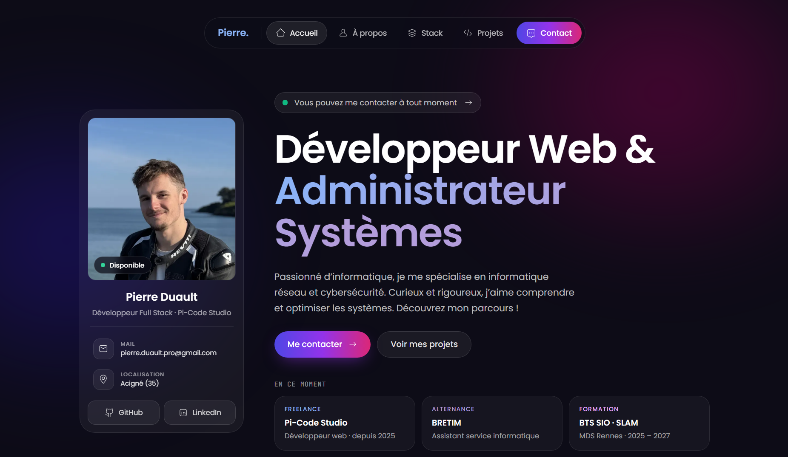
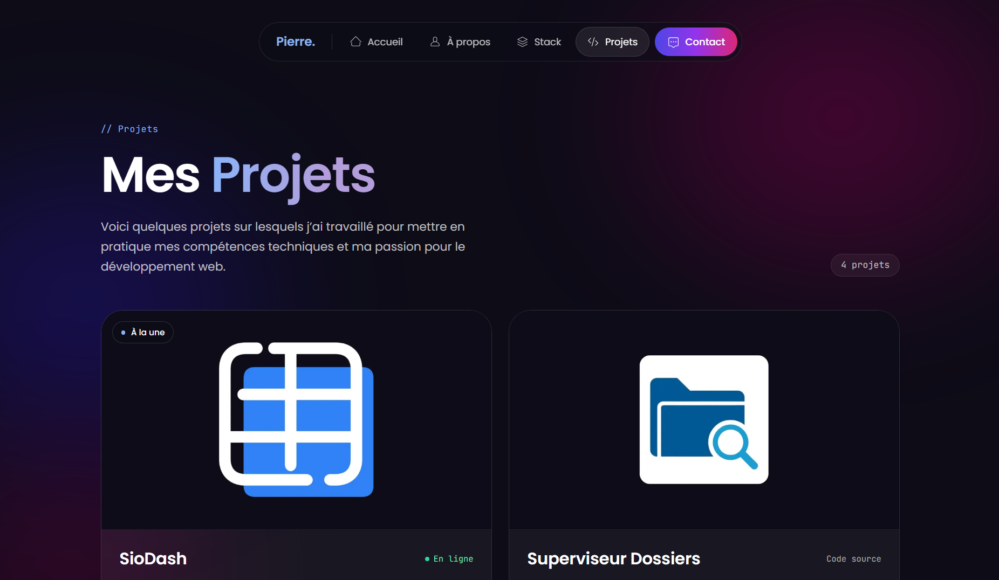
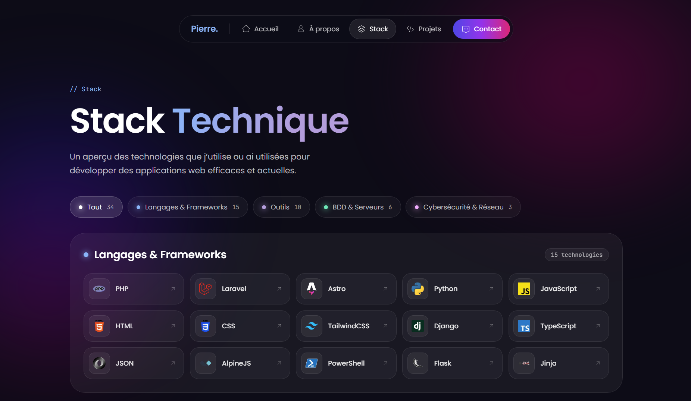
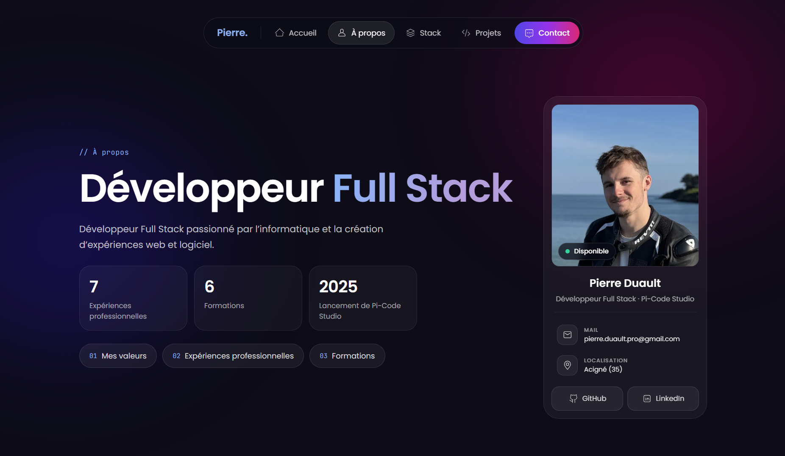
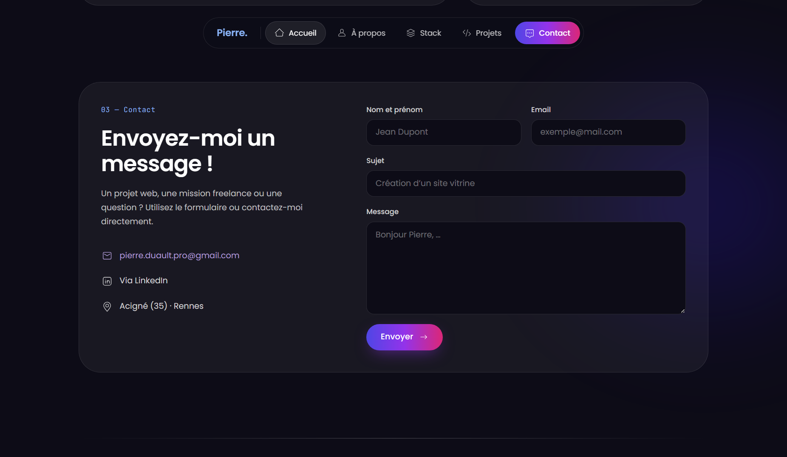

# Pierre Duault — Portfolio

[](https://pierre-duault.fr)
[](https://astro.build)
[](https://tailwindcss.com)

> Portfolio personnel de **Pierre Duault**, développeur web full stack & administrateur systèmes, basé à Rennes.
>
> Découvrez mes projets, mon parcours, ma stack technique et contactez-moi pour vos besoins en développement web.

---

## Apercu

### Accueil


### Projets


### Stack


### A propos


### Contact


---

## Fonctionnalites

- **Page d'accueil** — Presentation, carte de profil, projet mis en avant, apercu de la stack et section contact
- **Projets** — Galerie de projets personnels et professionnels avec fiches detaillees
- **Stack** — Inventaire complet des technologies, outils et environnements maitrises, avec filtres par categorie
- **A propos** — Valeurs, chiffres cles, experiences professionnelles en timeline repliable et formations
- **Contact** — Section de l'accueil (`/#contact`) : formulaire Formspree avec confirmation dans la page ; l'ancienne URL `/contact` y redirige
- **Pages legales** — Mentions legales, politique de confidentialite et CGU
- **SEO optimise** — Meta tags, Open Graph, Twitter Cards, sitemap
- **Design responsive** — Interface adaptee mobile, tablette et desktop (Tailwind CSS)

---

## Stack technique

| Categorie | Technologie |
|-----------|-------------|
| Framework | [Astro](https://astro.build) v7 |
| Styling | [Tailwind CSS](https://tailwindcss.com) v4 |
| Langage | TypeScript |
| Deploiement | [Vercel](https://vercel.com) |
| Domaine | [pierre-duault.fr](https://pierre-duault.fr) |

---

## Structure du projet

```text
/
├── public/               # Assets statiques (favicon, image Open Graph, scripts)
├── src/
│   ├── assets/           # Images et logos (projets, stack, entreprises)
│   ├── components/       # Composants Astro reutilisables
│   │   ├── icons/        # Icones SVG custom
│   │   ├── Card*.astro   # Cartes (projet, experience, formation, stack)
│   │   ├── navbar.astro
│   │   ├── footer.astro
│   │   └── ContactForm.astro
│   ├── content/          # Contenu editable en YAML (stack, experiences, formations)
│   ├── data/             # Donnees statiques (projets, contact)
│   ├── lib/              # Lecture du contenu YAML (tri, dates, filtrage)
│   ├── layouts/
│   │   └── Layout.astro  # Layout principal (SEO, meta, nav, footer)
│   ├── pages/            # Routes du site
│   │   ├── index.astro
│   │   ├── projects.astro
│   │   ├── stack.astro
│   │   ├── about.astro
│   │   └── legal, privacy, terms.astro  # Pages legales
│   └── styles/
│       ├── global.css
│       └── tailwind.config.js
├── src/content.config.ts # Schema du contenu YAML (verifie a chaque build)
├── astro.config.mjs      # Config Astro (sitemap, redirection /contact)
└── package.json
```

---

## Mettre a jour le contenu

La stack et le parcours se modifient dans trois fichiers YAML, sans toucher au code : dans VS Code, ou directement sur GitHub (bouton crayon, puis *Commit changes*) pour un deploiement automatique.

| Fichier | Contenu |
| :------ | :------ |
| `src/content/stack.yaml` | Technos de la page Stack, par categorie, et selection de l'accueil |
| `src/content/experiences.yaml` | Experiences professionnelles (timeline de la page A propos) |
| `src/content/formations.yaml` | Formations (page A propos) |

Chaque fichier rappelle ses champs dans son en-tete.

### Ajouter une techno

1. Deposer le logo (`.webp`) dans `src/assets/stacks/`
2. L'ajouter dans la bonne categorie de `stack.yaml`, a la position voulue (l'ordre du fichier est l'ordre d'affichage) :

```yaml
    - nom: Vue.js
      url: https://vuejs.org/
      logo: ../assets/stacks/vue.webp
      accueil: true   # facultatif : l'affiche aussi sur la page d'accueil
```

Logo sombre, illisible sur le fond ? Ajouter `inverser: true`.

### Ajouter une experience ou une formation

Ajouter une entree n'importe ou dans le fichier : elles sont triees par date de debut, la plus recente en premier.

```yaml
- debut: 2026-09
  fin: 2027-06          # sans fin : « AUJOURD'HUI » et badge « En cours »
  poste: Developpeur Full Stack
  entreprise: Exemple
  lieu: Rennes (35)
  logo: ../assets/logo-exemple.webp
  logoAlt: Logo d'Exemple
  missions:
    - titre: Developpement d'une API
      description: ...
```

Le libelle (« SEPT. 2026 – JUIN 2027 ») et le badge « En cours » sont calcules a partir de `debut` et `fin` (format `AAAA-MM`). Une fin a venir compte comme en cours. Comme le site est statique, cet etat est evalue au deploiement : le badge disparait au premier deploiement apres la date de fin.

### Desactiver (et reactiver) une entree

Ajouter `actif: false` a une techno, une experience ou une formation : elle disparait du site mais reste dans le fichier. Supprimer la ligne la reactive.

- une categorie dont toutes les technos sont desactivees est masquee, avec son filtre ;
- les chiffres cles de la page A propos ne comptent que les entrees actives.

### En cas d'erreur

Le build echoue avec un message explicite plutot que de publier une page incomplete :

- **erreur de syntaxe YAML** (indentation, guillemet non ferme) : le fichier et la ligne sont indiques ;
- **champ invalide** : `experiences → 4` designe la 4e entree du fichier, suivie du champ en cause (date mal formee, fin avant debut, champ manquant...) ;
- **logo introuvable** : `ImageNotFound` avec le chemin a corriger.

Lancer `npm run build` en local permet de verifier avant de pousser ; sur GitHub, la CI fait la meme verification.

---

## Commandes

Toutes les commandes s'executent depuis la racine du projet :

| Commande            | Action                                      |
| :------------------ | :------------------------------------------ |
| `npm install`       | Installe les dependances                    |
| `npm run dev`       | Lance le serveur de dev (`localhost:4321`)  |
| `npm run build`     | Build le site de production (`./dist/`)     |
| `npm run preview`   | Preview du build en local                   |
| `npm run astro ...` | Commandes CLI Astro (`add`, `check`, etc.)  |

---

## Deploiement

Le site est automatiquement deploye sur **Vercel** a chaque push sur la branche principale.

URL de production : [https://pierre-duault.fr](https://pierre-duault.fr)

---

## Auteur

**Pierre Duault** — Developpeur web full stack & administrateur systèmes

- Site : [pierre-duault.fr](https://pierre-duault.fr)
- Studio : Pi-Code Studio
